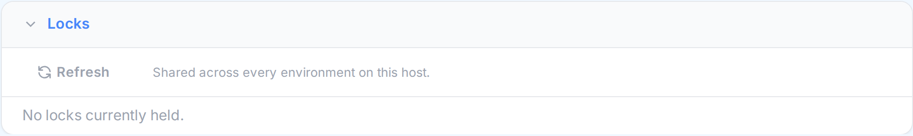
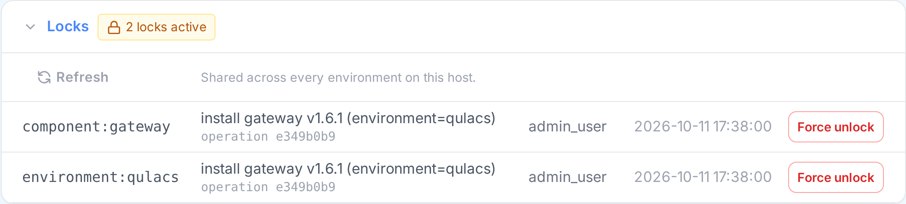

# Exclusive Locks

## Overview

This applies equally to all environments, regardless of type (**Backend**, **Cloud Local**, or any
other kind added later) — they all go through the same locking mechanism, described here once.

Install, uninstall, update, build, start, stop, restart, environment creation, and environment
deletion all run through the `oqtopus` CLI as a subprocess, and several of these operations write
to data that is **shared** rather than private to one environment:

- A component's release directory (`engine`, `gateway`, `tranqu` for Backend; `cloud`, `frontend`,
  `admin` for Cloud Local) lives outside any single environment and is reused by every environment
  on the same machine that resolves to the same version.
- The `sse_engine` service's Docker image, built by **Build SSE Runtime** (Backend only — Cloud
  Local has no equivalent), lives in the host's Docker image store, also shared across
  environments.

Running two such operations against the same shared resource at the same time can corrupt it —
for example, installing `gateway` from two different Backend environments at once can interleave
two extractions into the same release directory. OQTOPUS Manager prevents this with an **exclusive
lock** per shared resource: a second operation that targets a resource already in use either waits
for the first one to finish, or — for install, update and build — is refused outright (see
[What you'll notice](#what-youll-notice)).

## What gets locked

Locks are scoped to the smallest resource that's actually shared, so unrelated operations never
wait on each other:

| Operation | What it waits for |
|---|---|
| `install` / `uninstall` / `update` `<component>` | That component (host-wide) + this environment |
| `install all` | Every component (host-wide) + this environment |
| `start` / `stop` / `restart` `<service>` | That service, in this environment only |
| `start` / `stop` / `restart all` | Every service in this environment |
| Create environment | This environment (by name) |
| Delete environment | This environment (services + the environment itself) |
| Build SSE Runtime | The `engine` component (host-wide) |
| Device status, `versions` | Nothing — read-only |

Two consequences follow directly from this table:

- Installing `gateway` in environment A and starting `core` in environment B never wait on each
  other — different resources entirely.
- Starting `core` and starting `gateway` *in the same environment* don't wait on each other either
  — they're different services. Only two operations on the genuinely same component or the same
  service, anywhere, ever queue behind one another.

### Cloud Local: container-backed services

Cloud Local's `db` service runs as a Docker container rather than a plain process. Starting or
stopping `db` locks a shared "container group" scope for that environment rather than just `db`
itself, so that a future container-backed service added alongside it would correctly wait its turn
too. Today `db` is the only such service, so in practice this behaves exactly like locking `db` on
its own — it doesn't change anything about `worker`, `admin`, or any other Cloud Local service,
which each still lock only themselves.

## What you'll notice

What happens when the resource you need is already held depends on the operation:

- **Install, update, Build SSE Runtime** are **refused immediately**. The console shows an error
  naming the operation that holds the resource, who started it, and when. These run for minutes,
  so queueing silently behind another one would look like a hang. Try again once the other one
  finishes (watch it in the **Operations** panel, or in the **Locks** panel for another
  environment's). The one exception is repeating the *exact same* request — same environment,
  component, version and options — while it is still running: that doesn't conflict, it simply
  reattaches you to the running operation (see [Long-running Operations](operations.md)).
- **Everything else** (uninstall, start/stop/restart, environment create/delete) **waits** — the
  console shows nothing until the earlier operation finishes and yours begins. This is expected,
  not a hang, though it can take minutes if what you're waiting on is an install.

Note that install, update and build in one environment also hold that environment itself, so
installing `gateway` while `engine` is still installing *in the same environment* is refused too.

## Timeouts

Every locked operation has a timeout (`behavior.oqtopus_cli_operation_timeout_sec` in
`config.yaml`, default 10 minutes — see [Configuration](configuration.md)). If the underlying CLI
process hasn't finished by then, OQTOPUS Manager stops it **together with every process it
started** (for example a `docker build`), releases the lock, and reports a timeout in the console.
It first sends `SIGTERM` so they can shut down cleanly, then `SIGKILL` to anything still running
5 seconds later. The lock is released only once all of them have stopped, so nothing is still
writing to the shared resource when the next operation starts.

!!! tip
    The timeout is a hard limit on *working* operations too, not only on hung ones: an install or
    build that legitimately takes longer is stopped mid-way. If a first-time **Build SSE Runtime**
    or a large install can take more than 10 minutes on your machine, raise
    `oqtopus_cli_operation_timeout_sec`.

An operation counts as **finished as soon as the CLI process itself exits**: the console shows
the result and the lock is released at that moment. Processes the CLI deliberately leaves running
after it exits, for example the services started by **Start**, are not waited for and are never
stopped by the timeout. If the CLI ever exited while leaving something behind that was still
writing to a shared resource, that would be a bug in the CLI, not something Manager can guard
against.

Each CLI run is started in its own process session for this purpose. As a side effect, stopping
OQTOPUS Manager with Ctrl-C in a terminal no longer stops an install or build that is still running.
It continues in the background until it finishes. When Manager runs as a systemd service with the
default `KillMode=control-group`, stopping the service still stops them, since they remain in the
service's cgroup.

A timed-out `install` or `update` can leave the target component in an incomplete state. This is
expected and self-healing: the CLI detects an incomplete install and re-extracts it from scratch
the next time you install that same component, so **re-running the install is the recovery step**.

## Viewing locks in the UI

Every environment's detail page has a **Locks** panel, right below Service Status. It stays
collapsed and quiet when nothing is held, so it never gets in the way of the console or Service
Status above it:

As soon as anything is locked — anywhere, not just in this environment, since component locks are
shared across the whole host — a small badge appears with the count. Click it to expand the same
information `GET .../locks` returns: each lock's scope, the operation holding it, who started it,
and since when, plus a **Force unlock** button per row. A lock held by a running install, update
or build also shows the first characters of that operation's ID (`operation_id` in
`GET .../operations`, see [Long-running Operations](operations.md)):

The panel refreshes automatically every few seconds (and on demand via **Refresh**), so it reflects
locks taken out from any other environment's page, or by another person's session, without needing
to reload.

## If a lock seems stuck

`GET /api/backend/{name}/locks` and `GET /api/cloud-local/{name}/locks` list every lock currently
held, with what operation holds it, who started it, and since when — useful for confirming whether
an operation is still genuinely running or has been stuck far longer than it should ever take.
Either one shows the same, complete picture regardless of which environment's `{name}` you ask
through: a lock blocking your Backend install may have been taken out by a different Backend
environment, so the full snapshot is more useful here than a per-environment view would be. The
**Locks** panel described above is a thin UI over this same endpoint.

If you're confident a lock is stuck rather than merely slow, click **Force unlock** next to it in
the panel (or `POST /api/backend/{name}/locks/force-unlock?scope=<scope>` / the `cloud-local`
equivalent directly — either works, since both act on the same underlying set of locks).

!!! warning
    Force-unlocking does **not** stop the underlying CLI process — it may still be running and
    still writing to the resource the lock was protecting. Force-unlocking lets a *new* operation
    start concurrently with it, which is exactly the kind of collision locking exists to prevent.
    Use it only after confirming with `GET .../locks` that the holder is actually stuck, not just
    slow.

When the lock belongs to an install, update or build that is still running, the lock's row shows
that operation's ID (`operation_id` in `GET .../locks`), and the confirmation dialog warns that its
process is still running. You rarely need to force-unlock such a lock: a hung process is killed at
the operation timeout (see [Timeouts](#timeouts)), which releases the lock on its own.

If you force-unlock it anyway, the operation keeps running and is marked **lock force-released**
in the **Operations** panel (`lock_force_released` in `GET .../operations`), so anyone watching it
can tell that another operation may now be running concurrently with it. This is a deliberate
trade-off: killing the process instead would leave the component's directory half-written, which
is worse than letting it finish.

Viewing locks only requires `environment.get`, the same read-only permission as the rest of an
environment's status. The Force unlock button (and `POST .../locks/force-unlock` directly) requires
`environment.locks.manage`, a dedicated permission separate from the operations it may unblock —
see [Permissions](permissions.md).

## Limitations

- Locks live only in the Manager process's memory. Restarting Manager clears every lock — an
  in-flight operation loses its protection rather than staying stuck forever, which means a
  restart during an operation can allow a rare double-run, but never a permanently jammed lock.
  The [Operations](operations.md) list is cleared the same way.
- Locks only coordinate operations that go through OQTOPUS Manager. Running the `oqtopus` CLI
  directly on the host, outside of Manager, bypasses them entirely.
- A process that detaches itself into a new session (as daemons do) escapes the timeout's
  process-group stop, and keeps running after the operation has timed out.
- **Manager must run as a single process.** Locks don't coordinate across multiple Manager
  processes sharing the same filesystem, and that includes running Manager behind a server with
  several workers (e.g. `uvicorn --workers N`). Each worker would keep its own locks, so two
  workers could run conflicting operations at once. The default `python -m oqtopus_manager.main`
  (`make run`) starts a single process.

For implementation details (the `LockRegistry` API, how it wires into the streaming CLI wrapper,
and how to add locking to a new operation), see
[Developer Guidelines — Exclusive Locks](../developer_guidelines/locks.md).
