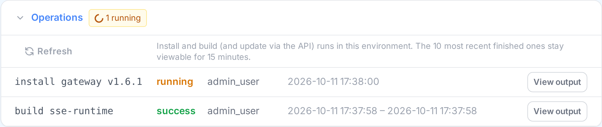

# Long-running Operations

## Overview

**Install** and **Build SSE Runtime** can take several minutes, as can update (available through
the [API](#api) only; in the UI, Install with an empty version does the same). They run on the
OQTOPUS Manager server, not in your browser, so they keep going no matter what happens to the page
that started them. You can close the tab, reload, lose your network connection, or watch from a
different browser — the operation finishes the same way, and you can see its output again at any
time.

This applies to both **Backend** and **Cloud Local** environments. Shorter operations (uninstall,
start/stop/restart, environment creation) are not affected: their output still streams only to the
page that started them.

## The Operations panel

Every environment's detail page has an **Operations** panel, just above the **Locks** panel. It
lists the install and Build SSE Runtime runs in that environment (plus update runs, which can only
be started through the [API](#api)), whether still running or recently finished, with who started
them and when. A badge in the panel header shows how many are running.



Click **View output** on any row to open its output in the console:

- While it is running, you first see the output so far, then the rest live as it is produced.
- Once it has finished, you see its output and how it ended (Done or Failed).

Anyone allowed to start these operations can watch any of them, including ones someone else
started. Several people (or tabs) can watch the same operation at once.

## What happens when…

**You close the tab or reload the page.** The operation keeps running. Reopen the environment's
page and click **View output** on it in the Operations panel.

**Your connection drops.** The console reconnects on its own (it shows "Reconnecting…") and
redraws the output, then carries on live. If it can't reconnect after a few attempts, it shows
"Connection lost". The operation itself is unaffected; open it again from the Operations panel
once you're back online.

**You click Install again for the same thing while it's still running.** Nothing new is started.
You are reattached to the running install instead. This only happens for an *identical* request
(same environment, component, version and options). Anything else that needs the same component
is refused — see [Exclusive Locks](locks.md#what-youll-notice).

If you leave the version empty ("latest") and click Install twice, the second click reattaches you
to the first install, which installs whatever "latest" was when *it* started. If a newer release
came out in between, run install again after the first one finishes.

## How long output is kept

- **Finished operations** stay in the Operations panel for **15 minutes** after they end, so you
  can still see the result if you missed it. After that they disappear. At most the **10 most
  recently finished** per environment are kept; older ones disappear sooner. Running operations
  are always listed.
- **Output** is kept for the most recent `operation_buffer_lines` lines per operation (1000 by
  default — see [Configuration](configuration.md)). A very long build can produce more than that;
  the earliest lines are then dropped, and the console shows how many were dropped. This panel is
  for following what is happening *now*, not a complete log of past runs.
- Everything is kept in the Manager process's memory only. **Restarting Manager clears the list**,
  just like it clears [locks](locks.md#limitations).

## API

| Request | Response |
|---|---|
| `POST /api/{template}/{name}/components/{component}/install` | `202` with `{"operation_id": "...", "already_running": false}`, or `already_running: true` when reattaching to an identical running request |
| `POST /api/{template}/{name}/components/{component}/update` | Same as install |
| `POST /api/backend/{name}/build-sse-runtime` | Same as install |
| `GET /api/{template}/{name}/operations` | The environment's running and recently finished operations, newest first |
| `GET /api/{template}/{name}/operations/{operation_id}/stream` | `text/event-stream`: the buffered output, then live output, ending with `event: done` and `data: success`, `error` or `timeout` |

`{template}` is `backend` or `cloud-local`. Each entry from `GET .../operations` has this shape:

```json
{
  "operation_id": "6d60b75371464abea0f8fa432c1fbeae",
  "kind": "install",
  "component": "engine",
  "version": "v1",
  "label": "install engine v1",
  "status": "running",
  "started_by": "alice",
  "started_at": "2026-10-11 16:02:47",
  "finished_at": null,
  "lock_force_released": false
}
```

`status` is `running`, `success`, `error` or `timeout`. Timestamps are UTC. `version` is `"latest"`
when none was given, and `null` for operations that take no version (update, build, `install all`).

Errors use `application/problem+json` ([RFC 9457](https://www.rfc-editor.org/rfc/rfc9457)):

| Status | When |
|---|---|
| `400` | Unknown component |
| `404` | Unknown environment, or an operation ID that doesn't exist, has expired, or belongs to another environment |
| `409` | The component or environment is held by another operation. `detail` names it. No operation is started |

All of these endpoints require `environment.component.manage` (see [Permissions](permissions.md)).
Without it, the Operations panel is hidden.
